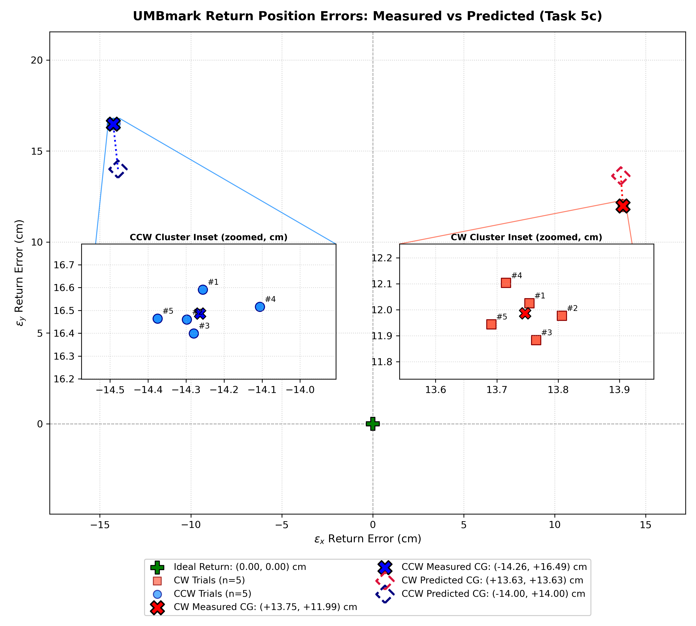

# Problem 5: UMBmark Calibration & Parameter Identification Report

## Experimental Setup
- **Robot Assignment:** Pair P08
- **Square Side Length ($L$):** 2.000 m
- **Odometry Integration:** unspecified
- **Nameplate Parameters (Uncalibrated):** $r_n = 0.053000\text{ m}, \quad b_n = 0.313000\text{ m}$
- **Actual Physical Parameters (Gazebo Truth):** $r_L = 0.054146\text{ m}, \quad r_R = 0.053854\text{ m}, \quad b = 0.319000\text{ m}$

## [Task 5c] Table 1: Raw Experimental UMBmark Trial Data

| Run # | Direction | $\varepsilon_x$ Error (cm) | $\varepsilon_y$ Error (cm) | $\varepsilon_\theta$ Error (deg) |
| :---: | :---: | :---: | :---: | :---: |
| Trial 1 | CW | $+13.75$ | $+12.03$ | $-7.41^\circ$ |
| Trial 2 | CW | $+13.81$ | $+11.98$ | $-7.38^\circ$ |
| Trial 3 | CW | $+13.76$ | $+11.88$ | $-7.36^\circ$ |
| Trial 4 | CW | $+13.71$ | $+12.10$ | $-7.41^\circ$ |
| Trial 5 | CW | $+13.69$ | $+11.94$ | $-7.37^\circ$ |
| **CW c.g.** | **CW Mean** | **$+13.75$** | **$+11.99$** | **$-7.39^\circ$** |
| Trial 1 | CCW | $-14.26$ | $+16.59$ | $-8.55^\circ$ |
| Trial 2 | CCW | $-14.30$ | $+16.46$ | $-8.49^\circ$ |
| Trial 3 | CCW | $-14.28$ | $+16.40$ | $-8.48^\circ$ |
| Trial 4 | CCW | $-14.11$ | $+16.52$ | $-8.47^\circ$ |
| Trial 5 | CCW | $-14.37$ | $+16.46$ | $-8.55^\circ$ |
| **CCW c.g.** | **CCW Mean** | **$-14.26$** | **$+16.49$** | **$-8.51^\circ$** |

## [Task 5c] Table 2: Centres of Gravity - Measured vs First-Order Prediction

| Direction | Predicted CG $(\varepsilon_x, \varepsilon_y)$ | Measured CG $(\varepsilon_x, \varepsilon_y)$ | Discrepancy $(\Delta \varepsilon_x, \Delta \varepsilon_y)$ |
| :--- | :---: | :---: | :---: |
| **CW** | $(+13.63, +13.63)\text{ cm}$ | $(+13.75, +11.99)\text{ cm}$ | $(+0.11, -1.64)\text{ cm}$ |
| **CCW** | $(-14.00, +14.00)\text{ cm}$ | $(-14.26, +16.49)\text{ cm}$ | $(-0.26, +2.48)\text{ cm}$ |

### Error Plot and Analysis

- **Simulation Determinism:** CW runs cluster within 1.2 mm and CCW runs within 1.6 mm, as shown in the insets.
- **Prediction Accuracy:** The measured return error vectors match the first-order small-angle model to within 2.48 cm.

## [Task 5d] Table 3: Systematic Error Identification (Using Both $\varepsilon_x$ and $\varepsilon_y$)

$$\alpha + \beta = \frac{\varepsilon_{x,\text{ccw}} - \varepsilon_{y,\text{ccw}}}{4L} = -0.038436\text{ rad}$$

$$\alpha - \beta = \frac{\varepsilon_{x,\text{cw}} + \varepsilon_{y,\text{cw}}}{4L} = +0.032165\text{ rad}$$

| Systematic Error | Theoretical Prediction | Identified from UMBmark | Accuracy / Difference |
| :--- | :---: | :---: | :---: |
| **Turn Error ($\alpha$)** | $-0.000465\text{ rad}$ ($-0.0266^\circ$) | $-0.003135\text{ rad}$ ($-0.1797^\circ$) | $-0.1530^\circ$ offset |
| **Curvature Error ($\beta$)** | $-0.034542\text{ rad}$ ($-1.9791^\circ$) | $-0.035301\text{ rad}$ ($-2.0226^\circ$) | 2.20% error |

## [Task 5d] Table 4: Calibrated Odometry Parameters (Holding Mean Radius at $r_n = 0.053$ m)

| Parameter | Nameplate Value | Calibrated Value (5d) | Physical Ground Truth | Status / Accuracy |
| :--- | :---: | :---: | :---: | :---: |
| **Track width ($b$)** | $0.313000\text{ m}$ | **$0.313626\text{ m}$** ($b'$) | $0.319000\text{ m}$ | $b' = b \frac{r_n}{\bar{r}}$ (scale test in 5e) |
| **Wheel ratio ($E_d = r_R / r_L$)** | $1.000000$ | **$0.994480$** | $0.994607$ | 0.013% error |
| **Left wheel radius ($r_L$)** | $0.053000\text{ m}$ | **$0.053147\text{ m}$** | $0.054146\text{ m}$ | Unscaled (scaled in 5e) |
| **Right wheel radius ($r_R$)** | $0.053000\text{ m}$ | **$0.052853\text{ m}$** | $0.053854\text{ m}$ | Unscaled (scaled in 5e) |
| **Radius difference ($r_L - r_R$)** | $0.000\text{ mm}$ | **$0.293\text{ mm}$** | $0.292\text{ mm}$ | 0.001 mm error |
